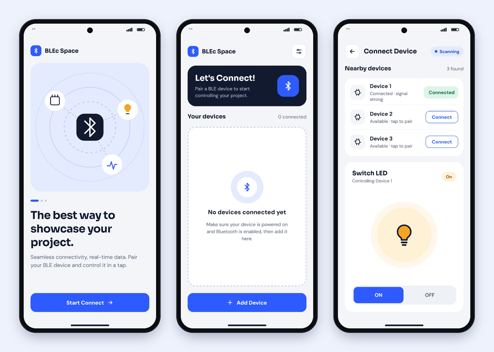

# BLEc Space — Flutter × ESP32 over Bluetooth Low Energy

An Android app built with Flutter that scans for nearby ESP32 boards, connects to them over **Bluetooth Low Energy (BLE)**, and switches the board's LED on and off. The ESP32 reports the LED state back through BLE notifications, so the app stays in sync even when the LED is toggled from the board itself.

The repo contains both sides: the **Flutter app** and the **ESP32 firmware**.




## Features

- **Filtered BLE scan** that only lists boards advertising the BLEc service UUID, with signal strength shown for each
- **Connect and disconnect** multiple boards. Tap a connected board to control it, or long-press to disconnect.
- **LED control**: ON/OFF commands are written to a GATT characteristic
- **Two-way sync**: the app subscribes to notifications, so a state change on the board (e.g. pressing the BOOT button) shows up in the app right away
- Handles Bluetooth turned off, Android 12+ runtime permissions, and dropped connections (for example when the ESP32 resets or goes out of range)

## How It Works

```
┌──────────────┐        BLE (GATT)         ┌───────────────────┐
│ Flutter app  │ ── scan by service UUID ─▶│ ESP32 "BLEc-ESP32"│
│              │ ── write "ON" / "OFF" ───▶│  LED char (R/W/N) │──▶ GPIO 2 LED
│              │ ◀── notify "ON"/"OFF" ────│                   │
└──────────────┘                           └───────────────────┘
```

| Item | UUID |
|---|---|
| Service | `4fafc201-1fb5-459e-8fcc-c5c9c331914b` |
| LED characteristic (read / write / notify) | `beb5483e-36e1-4688-b7f5-ea07361b26a8` |

The UUIDs live in [`lib/config/ble_config.dart`](lib/config/ble_config.dart) and at the top of the firmware file. They must match on both sides.

## Project Structure

```
blec-space/
├── lib/
│   ├── main.dart
│   ├── config/ble_config.dart          # UUIDs, commands, timeouts
│   ├── services/ble_service.dart       # all BLE logic (scan, connect, notify, write)
│   ├── screens/                        # welcome, home, connect device
│   ├── widgets/                        # device tile, LED card, header, buttons, etc.
│   └── theme/app_theme.dart
├── firmware/esp32_ble_led/
│   └── esp32_ble_led.ino               # ESP32 BLE GATT server
├── android/app/src/main/AndroidManifest.xml   # Bluetooth permissions
├── docs/design/                        # UI mockups
└── pubspec.yaml
```

## Getting Started

### 1. Flash the ESP32

1. Install the Arduino IDE and add **esp32 by Espressif** in Boards Manager (v2.x or v3.x both work).
2. Open `firmware/esp32_ble_led/esp32_ble_led.ino`.
3. If you use more than one board, give each one a unique `DEVICE_NAME`.
4. Select your board, then click **Upload**.
5. Open the Serial Monitor at 115200 baud. You should see `BLEc-ESP32 ready`.

The firmware uses the built-in LED on GPIO 2. For an external LED, connect it to `LED_PIN` through a 220 Ω resistor.

### 2. Run the app

Requires Flutter 3.24+ and an Android phone with BLE (emulators don't support Bluetooth).

```bash
git clone https://github.com/syahiiralhaddad/blec-space.git
cd blec-space
flutter create --platforms=android --project-name blec_space .   # generates the missing Android scaffolding, keeps existing files
flutter pub get
flutter run            # or: flutter build apk
```

The committed `android/app/src/main/AndroidManifest.xml` already includes the Bluetooth permissions. On Android 12 and above, the app asks for the *Nearby devices* permission the first time it scans.

## Tech Stack

Flutter · Dart · [flutter_blue_plus](https://pub.dev/packages/flutter_blue_plus) · ESP32 (Arduino core, BLE GATT server)

## Notes

- `flutter_blue_plus` 2.x is free for personal and educational use (`License.nonprofit` in `ble_service.dart`). Commercial use requires a commercial license from its author.
- This started as a one-week course practice ("retrieve data via BLE to the ESP32 from a Flutter app"). It was later rebuilt with a new UI and a more reliable BLE layer.
